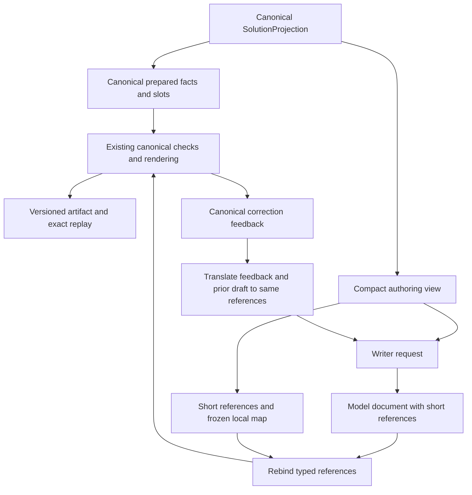

# Compact Results M2 Input - Plan

## Goal Capsule

Reduce Results M2 authoring input while preserving useful choices, factual binding, conditions and model control of the answer.
Use a compact model-facing catalog with short J/A/C references, reusable facts and explicit rejected-result summaries.
On 2026-10-20 the owner explicitly authorized implementation under `$implement`, the bounded Luna evaluation below, and committing the completed work to the current branch. This authorization supersedes the original statement that this plan alone authorizes no implementation or paid calls.
Ranking and earlier stages remain closed; no provider calls are authorized.
The live diagnostic is limited to three saved cases, at most three initial generations and three corrections, and at most six associated token-count requests. No automatic reruns or broader cohort are authorized.
The live evaluation records diagnostic evidence; it does not qualify M2 or M3.

**Implementation status, 2026-10-20:** Offline implementation and preservation checks
are complete using `results-artifact-v5` / `results-prepared-v4`. Complete initial
request JSON is smaller by 64.13% (admitted), 63.42% (conditional), and 32.11%
(incomplete); these are byte reductions, not new token counts. The bounded Luna
diagnostic completed with five generations/five count requests; admitted and incomplete
were mechanically clean, while conditional remained annotated. See the [case evidence](../evidence/results-stage/m2/compact-input/2026-10-20-luna/README.md).
The repository test run completed with 878 passed, 99 skipped and two known gfly
environment failures before the narrow post-live fix. The final combined
Results/evaluation/harness gate then passed 162 tests in 172.36 seconds, with final
mypy and scoped Ruff checks passing. The V5-specific seed-37 replay issue was fixed
and passed the seven-artifact, three-seed matrix; the historical finding-order issue
remains separate. See the [case evidence](../evidence/results-stage/m2/compact-input/2026-10-20-luna/README.md)
and [build log](../build-log/2026-10-20-results-m2-compact-input.md) for details.
No qualification or owner acceptance follows from these engineering checks or the
three-case diagnostic.

---

## Product Contract

### Summary

Separate the complete canonical Results evidence from the material the writer reads.
Retain every admitted and conditional candidate in the first compact version, omit individual rejected candidates from the recommendation catalog, and keep the full projection locally.
Group matching observations' common facts once while retaining each member as an individually selectable source.

### Problem Frame

Saved presentation iteration 006 used 822,377 initial input tokens for the admitted case, 732,878 for conditional and 253,293 for incomplete.
The first two inputs include hundreds of rejected journeys, repeated long hashes and repeated disclosure/cost structures.
The incomplete case has no complete candidates but still contains 383 component observations.
The goal is reduced authoring cost and context load without substituting a narrow code-selected shortlist for useful traveler choice.

The investigation measured payload bytes using read-only compact JSON serialization; its transformed inputs were sizing simulations, not validated production contracts or measured token savings.
The combined scenario reached approximately 0.67/0.60/0.44 MB from 2.21/1.96/0.74 MB before adding replacement exclusion summaries.
These figures justify implementation exploration, not an exact savings promise.

### Requirements

**Candidate coverage**

- R1. Every admitted or conditional canonical journey remains individually selectable in the compact catalog.
- R2. Rejected journeys cannot become recommendations; replace their individual catalog rows with source-backed exclusion counts/reasons, preserving material route/date scope and coverage limitations.
- R3. Preserve distinct incomplete leads and separate cash benchmarks with their original dispositions and decision-relevant evidence.
- R4. Preserve differences in program, airports, local schedule and arrival date, cabin evidence, price/scope/completeness, freshness, conditions and separate-ticket obligations.

**Authoring and evidence**

- R5. Use short typed J/A/C references for journey, award and cash records, with a deterministic mapping to canonical source identities.
- R6. Keep full canonical facts, identities and receipts local for existing factual substitution, checking and replay.
- R7. Preserve model ownership of selection, headings, ordering, grouping and prose, plus current required disclosures and bounded correction.
- R8. Model-facing metadata removal must preserve unknown/absent states and every distinction needed to choose or explain an option.
- R9. Comparison claims retain the original complete comparison scope and Ranking references, independent of which options the writer displays.

**Compatibility and measurement**

- R10. Historical artifact versions retain their original request/replay semantics; new compact authoring uses an explicit new version.
- R11. Measure the complete initial and correction requests, retaining separate byte, token and quality evidence.
- R12. Do not tie input candidate coverage to the current three-option guidance; future output expansion remains a separate change.

**Observation grouping**

- R13. Factor matching reported facts into model-facing groups without deleting canonical candidates or choosing a latest representative; retain each member's selectable reference, exact retrieval timestamp and source binding.

### Scope Boundaries

No Ranking policy changes, style-only filtering, universal cost/time dominance, top-K cap, added LLM selection call, retrieval tool loop or provider acquisition.
No expanded-output behavior change in this work: existing guidance and the over-five soft finding remain until the owner specifies the later output revision.
No global identifier replacement in prose or provider strings.

#### Deferred to Follow-Up Work

Canonical observation deletion, latest-observation replacement and upstream physical-query coalescing remain outside this work.
Revisit only if model-facing grouping under R13 is insufficient, with a separately accepted source-replacement or Provider policy and preservation evidence.
Broader diversity shortlisting requires its own explicit omission policy and owner-reviewed counterexamples.

---

## Planning Contract

### Key Technical Decisions

- KTD1. Put representation changes in Results, leaving the canonical Ranking projection and its digest intact. Governs R6/R10. This avoids reopening Ranking or weakening its preservation contract.
- KTD2. Retain short J/A/C handles instead of removing references or repeating every component inline. Governs R5. (session-settled: user-approved — chosen over removing all references or nesting all components: the owner accepted reliable option binding and reusable A/C records.)
- KTD3. Introduce a small Results authoring-view module, proposed as `src/award_agent/results/authoring.py`. Candidate rows carry direct decision fields and link to an award plus optional cash record; factor detailed repeated facts without creating a many-table join puzzle. Governs R1/R3/R4/R8.
- KTD4. Add a new prepared/artifact version, implemented as `results-prepared-v4` / `results-artifact-v5`. Store the compact view, typed canonical map and their binding digest alongside canonical prepared facts. Governs R5/R6/R10.
- KTD5. Rebind model response references before existing canonical document checks/rendering. Convert correction feedback and the prior document back into the same frozen alias namespace for the second call. Keep raw model responses as originally returned. Governs R5/R7.
- KTD6. Replace repeated required-key arrays with disclosure profiles and explicit candidate exceptions. Retain slot vocabulary and grammar guidance; exceptions cover mixed-cabin keys and exact-equality schedule aliases. Governs R7/R8.
- KTD7. Remove model-facing query/transport lineage, source-field paths, hashes and redundant timing arithmetic only after a field-by-field preservation review. Supply concise coverage, exclusion and condition facts rather than dropping the underlying meaning. Governs R2/R4/R8.
- KTD8. Give comparison scope a typed full-pool handle that expands locally to the original canonical pool. Keep supported comparison values, scope and completeness visible to the writer. Governs R9.
- KTD9. Group common journey/component facts only within the same saved run when canonical decision facts, resolved costs, eligibility/conditions, query semantics and retained evidence hashes agree. Keep administrative identities and retrieval times as distinct member metadata, with the writer selecting a concrete member through its existing short reference. Missing or uncertain equivalence leaves separate compact records. Governs R1/R4/R6/R9/R13. (session-settled: user-approved — chosen over repeating every observation or keeping only the latest: reduce repeated input while preserving both sources and their factual bindings.)

Grouping under KTD9 does not establish unique physical-flight identity, stronger availability evidence or newer inventory.
Do not combine known fields from one member with unknown fields from another, or use a small retrieval-time gap as an equivalence rule.
Canonical candidate counts and complete-pool comparisons remain unchanged by grouping.

### High-Level Technical Design

The request carries compact facts and references; the artifact also retains the complete canonical source.
Do not include the canonical reverse map or full canonical prepared source in the compact request.
Unknown or wrong-kind aliases must never bind to another option; translate them into an explicit invalid-reference finding or the existing unavailable-detail path without a guessed fallback.
When a draft has recoverable valid parts, retain the existing bounded-recovery and annotated-delivery behavior.

### Assumptions and Limits

The accepted rejected-summary policy narrows the earlier requirement that every detailed alternative appear in writer input. ADR 0026 and the current contracts record this supersession; canonical evidence and every eligible choice remain preserved.
No eligible canonical candidate is merged or removed; R13 changes only how repeated facts are represented to the writer.
The compact source can remain in one authoring call; whether the model reads the new encoding equally well requires later live evidence.
Aim for at least 60% payload-byte reduction in each saved complete-results case and 35% in the incomplete case; these are proposed engineering targets, not authority to drop useful facts or evidence.
If a target is missed, report which fields dominate before adding further filtering.

---

## Implementation Units

### U1. Establish the compact contract and independent baseline

**Goal:** Pin what must survive before changing serialization.
**Requirements:** R1–R4, R8, R10–R13.
**Dependencies:** None.
**Files:** `src/award_agent/results/contracts.py`; proposed `tests/unit/test_results_authoring_view.py`; `tests/unit/test_results_evidence.py`; proposed `scripts/measure_results_authoring.py`.

**Approach:** Define typed authoring records and a field disposition manifest: retained, factored, locally retained, or summarized, with rationale. Build the preservation oracle from canonical projection fields rather than the new serializer. Capture source hashes and baseline request sizes from the three frozen iteration 006 artifacts. The measurement utility is offline by default and reports instructions, schema, payload and correction overhead separately.

**Test scenarios:**

1. Baselines reconcile to the saved 618/528/0 candidates and saved usage receipts without requesting token counts.
2. Canonical contrasts differing only in program, local arrival date, quote scope, missing fees, cabin evidence, conditions or freshness remain distinguishable.
3. Planted omission of a decision field is detected independently of serializer round-trip equality.
4. Canonical field and receipt comparisons independently establish the grouping predicate, including resolved cost components and query semantics rather than prepared-field equality alone.

**Verification:** A reviewed field manifest and reproducible baseline precede representation changes.

### U2. Build the compact catalogs and source summaries

**Goal:** Reduce repeated data while preserving candidate choice.
**Requirements:** R1–R4, R7–R9, R13; KTD3/KTD6/KTD7/KTD8/KTD9.
**Dependencies:** U1.
**Files:** proposed `src/award_agent/results/authoring.py`; `src/award_agent/results/core.py`; `src/award_agent/results/contracts.py`; proposed `tests/unit/test_results_authoring_view.py`.

**Approach:** Create compact eligible journey, reusable award/cash, benchmark and incomplete catalogs. Remove records unreachable from these catalogs only when their information is not needed by summaries or comparison authority. Replace per-candidate disclosure lists with profiles plus exact exceptions. Preserve slot vocabulary. Build exclusion and coverage summaries deterministically from trusted source facts.
Apply KTD9 using shared common facts and explicit member references/timestamps; do not introduce group-level output references or a representative-selection policy.

**Test scenarios:**

1. All 258/232 eligible saved candidates remain selectable; rejected records are absent from recommendation rows and accounted for by source-backed summaries.
2. Incomplete-only input retains all distinct lead and benchmark identities and its no-complete-journey distinction.
3. Partial coverage, missing quote scope and absent cabin evidence remain explicit.
4. Direct awards with connections are not described as nonstop; separate-ticket schedules retain distinct component facts.
5. Disclosure profiles reproduce canonical required keys, including mixed-cabin and matching-schedule exceptions.
6. The 116 matching pairs per saved complete-results case share repeated facts while all 258/232 original eligible candidates remain selectable. Record group counts separately from canonical candidate counts.
7. Same-route/schedule observations with United at USD 135 and American at USD 176 remain separate; differences in program, price scope, conditions, query semantics or retained evidence also prevent grouping.
8. Retrieval timestamps remain member-specific; matching missing flight-number or cabin fields neither creates physical-flight certainty nor strengthens evidence.

**Verification:** The independent oracle passes for every retained candidate/component, and summary counts reconcile without silently changing source eligibility.

### U3. Integrate aliases across authoring and correction

**Goal:** Keep exact factual binding despite short model-facing references.
**Requirements:** R5–R9/R11/R13; KTD2/KTD5/KTD8/KTD9.
**Dependencies:** U2.
**Files:** `src/award_agent/results/request.py`; `src/award_agent/results/adapter.py`; `src/award_agent/results/core.py`; proposed `src/award_agent/results/authoring.py`; `tests/unit/test_results_adapter.py`; `tests/unit/test_results_token_measurement.py`; proposed `tests/unit/test_results_authoring_view.py`.

**Approach:** Use the compact request for both counting and generation. Translate selection IDs, scoped part references, claim scopes and shared-disclosure targets through the typed map. Bind references before canonical validation. Build correction payloads using the original compact view and namespace. Retain one initial attempt plus at most one correction; no additional selection call.

**Test scenarios:**

1. A fake writer selects J1/A1/C1 references and produces canonical selections and identical bound source values.
2. Repeated/interleaved parts, shared facts and benchmark/incomplete parts bind to the correct source.
3. Unknown references, wrong types and duplicate mappings cannot bind to an unrelated source.
4. Corrective feedback and previous drafts contain the same short references, with no accidental canonical hashes reintroduced.
5. Full-pool comparison shorthand expands to the original eligible pool, not the selected subset.
6. Count and generation requests match on all token-bearing fields; failure paths preserve existing recoverable initial drafts.
7. Selecting either member of a grouped pair binds its own original observations and retrieval times through initial authoring and correction; no implicit latest-member fallback occurs.

**Verification:** Fake-client integration covers the real request builder and correction path without network access.

### U4. Version artifacts and preserve replay

**Goal:** Make compact authoring traceable without changing saved historical behavior.
**Requirements:** R6/R10/R11; KTD1/KTD4/KTD5.
**Dependencies:** U3.
**Files:** `src/award_agent/results/contracts.py`; `src/award_agent/results/core.py`; `tests/unit/test_results_evidence.py`; `tests/unit/test_results_cli.py`; proposed `tests/unit/test_results_authoring_view.py`.

**Approach:** Persist the frozen compact view/map, digests and raw writer response in the new version; store canonical rebound documents for existing checks. Replay verifies the view/map binding and selected scope associations offline. Historical versions dispatch through their original serialization and rendering paths. Exercise existing API, CLI and harness call sites without new UI policy or an extra runtime mode.

**Test scenarios:**

1. Historical V1–V4 request construction and known-good answer bytes remain unchanged.
2. New artifacts round-trip and replay across processes/hash seeds with stable alias assignment.
3. Tampered maps or compact views fail binding checks.
   Group membership and member-specific timestamps are included in the verified binding.
4. Frozen offline documents follow an explicit canonical-input path; aliases are confined to the live-writer boundary, avoiding accidental reinterpretation of existing offline drafts.
5. API, CLI and harness frozen-writer paths preserve their existing behavior.

**Verification:** The V5-specific incomplete/benchmark finding-order defect discovered in the first cross-seed run was fixed after live evaluation; post-fix replay passed all three V5 artifacts plus saved V1–V4 artifacts at seeds 11, 23 and 37, with original live artifacts and requests unchanged. Tampered/reordered finding controls remain rejected. This narrow result does not claim the separately recorded historical finding-order concern is resolved.

### U5. Run offline acceptance and record evidence

**Goal:** Demonstrate reduction and preservation before spending on generation.
**Requirements:** R1–R13.
**Dependencies:** U4.
**Files:** proposed `scripts/measure_results_authoring.py`; proposed `evidence/results-stage/m2/compact-input/`; `docs/results-m2.md`; `docs/project-state.md`; `docs/adr/0026-model-authored-results-with-bound-facts.md`; `docs/adr/README.md`; `DEFERRED.md`; a dated `docs/build-log/` entry.

**Approach:** Produce before/after complete-request accounting for initial and correction inputs on all three frozen cases, including hashes, counts, dispositions and preservation results. Use independent canonical fixtures containing seven and ten choices to test alias selection/rendering breadth while retaining current over-five soft findings. Amend ADR 0026 and affected current contracts to identify precisely which canonical evidence stays local and which rejected details leave writer input. Record no output-policy expansion or live qualification.

**Test scenarios:**

1. Full request accounting includes instructions, strict schema, compact source, feedback and prior document; local slot maps and canonical reverse maps are absent from the writer request.
2. Seven/ten-choice documents retain distinct identities and correct factual bindings, including several variants from one award family.
3. A missed reduction target yields an honest report, not extra pruning or a success-shaped fallback.
4. Accounting separates alias/field compaction, rejected-record removal and observation grouping so their overlapping reductions are not added together or reported as measured tokens.

**Verification:** Offline gates below pass; documentation distinguishes measured bytes, saved historical token receipts and unmeasured new token counts.

---

## Verification Contract

| Gate | Evidence and command | Acceptance |
|---|---|---|
| Preservation | Proposed authoring-view tests plus independent canonical field assertions | Every eligible option and required decision distinction survives |
| Results regression | `.venv/bin/pytest tests/unit/test_results*.py -q` | New tests and existing Results checks pass; investigate failures before claiming completion |
| Harness integration | `.venv/bin/pytest tests/unit/test_harness_pipeline.py tests/unit/test_harness_workflow_ui.py -q` | Existing offline call paths work without live calls |
| Static checks | `.venv/bin/ruff check src/award_agent/results` and `.venv/bin/mypy src/award_agent/results` | Changed production code passes; include new test/script paths in scoped lint checks |
| Accounting | Proposed offline measurement utility over frozen cases and representative correction documents | Reproducible component and complete-request bytes, no bytes-to-tokens substitution |
| Replay | Historical known-good fixtures and new multi-process/hash-seed tests | Preserve historical bytes and verify new mappings without network access |

### Separate live validation gate

The owner explicitly lifted the prior stop for this bounded experiment on 2026-10-20. Use the same frozen projections and comparable guidance as iteration 006, reusing historical baseline receipts instead of rerunning the large baseline.
Run the admitted, conditional and incomplete cases: at most three initial generations and three corrections, with at most six associated token-count requests; no provider calls or automatic reruns.
This is a small diagnostic, not broad qualification. Do not exceed these limits without new explicit authorization.

Record actual initial/correction input tokens, output tokens, total authoring usage, time, correction rate, delivery outcome and actual cost under the approved pricing assumptions.
Review options against the canonical source for meaningful choices, correct facts and conditions, readable presentation and lost diversity.
Do not treat a mechanically clean answer as proof of useful selection or semantic truth.
If the later expanded-output change is ready, add its explicitly scoped cohort and budget separately; offline alias breadth tests do not establish expanded live-answer quality.
Preserve originals and write new artifacts to separate paths.

---

## Definition of Done

The offline implementation is complete when U1–U5 pass, candidate preservation and reference binding are demonstrated, full-request reduction is reported, historical behavior remains compatible, and ADR/contracts/build-log/deferred entries accurately describe the change.
The artifact remains a complete local evidence record even though the writer receives a smaller view.
No accepted option loss, claim-scope narrowing or hidden freshness decision is permitted to meet a size target.
Live token savings and answer-quality acceptance remain unclaimed until this authorized bounded diagnostic completes and its outputs are reviewed. Its completion does not establish broad qualification or change the separate output-breadth policy.

## Sources

- Owner discussion on input reduction, retaining A/C references, and later output expansion, 2026-10-20.
- Owner acceptance of model-facing observation grouping with concrete member references and both source histories retained, 2026-10-20.
- `docs/project-state.md` and `DEFERRED.md`.
- `docs/adr/0026-model-authored-results-with-bound-facts.md`.
- `docs/handoffs/2026-10-07-results-m2-implementation-spec.md` and `docs/handoffs/2026-10-07-results-m2-validation-and-delivery-contract.md`.
- `src/award_agent/results/{contracts,core,request,adapter}.py`.
- `evidence/end-to-end/presentation/iterations/006/{admitted,conditional,incomplete}/artifact.json`.
- `docs/build-log/2026-10-09-results-m2-presentation.md`.
