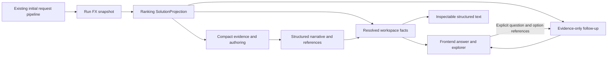

# Structured Results and local flight workspace

**2026-10-29 category-led closeout:** The later owner-authorized campaign ran
c01–c20 and stopped at its ceiling without qualification. Category-preserving
selection, source-resolved cards and replay are implemented as opt-ins; the final
candidate still repeats a condition in one saved answer. No default adoption or
current M2 acceptance follows; U4–U7/Frontend/M3 remain separate. See the
[campaign](../../evidence/results-stage/m2/structured/2026-10-29-category-led/README.md)
and [implementation/evaluation log](../build-log/2026-10-29-results-category-led.md).
No c21 or unused-budget continuation is authorized.

**Earlier 2026-10-29 handover (historical):** Implementation stopped at the owner's request; see the
[new-session handover](../handoffs/2026-10-29-results-m2-fast-profile-handover.md)
for V3–V30 cycles and pending Ranking-led authoring direction. Luna wording stays;
inline comparison binding was rejected; full-cash context is one brief sentence.
No default qualification, frontend milestone or M3 closeout follows.

## 2026-10-28 backend fast-profile disposition

The owner-invoked Luna iteration stopped at the owner's V30 ceiling. V30's three
saved cases meet the approximately20-second normal timing goal and pass H/U/M2,
but two remain basic in comparative depth. No new confirmation or live V30 repair
followed that failed gate. The public API/CLI V27 default wiring remains provisional
and failed qualification; V30 remains opt-in. Neither a qualified default nor M2
owner closeout follows. See the [campaign](../../evidence/results-stage/m2/structured/2026-10-28-fast-default/README.md)
and [session log](../build-log/2026-10-28-results-fast-default.md) for original
failures, exact requests, offline checks and the requested whole-change review.
U4–U7, frontend integration, owner presentation acceptance and M3 keep their
separate milestones. No upstream Ranking or provider boundary changes.

## Goal Capsule

**Objective:** Travelers can understand the highlighted flight choices, compare their tradeoffs, and inspect the other options found without parsing dense itinerary paragraphs.

**Means:** A structured, source-resolved answer rendered in a local frontend alongside a complete grouped explorer (KTD1–KTD4).

**Authority:** Current owner instructions, `AGENTS.md`, `docs/project-state.md`, ADR 0029 and the Product Contract below. ADRs 0024/0025/0027 retain upstream matching, style and export authority. ADR 0026 remains authoritative for historical artifacts and unchanged authoring/recovery guarantees.

**Execution profile:** The October 23 session authorized documentation and planning only. On October 24 the owner opened Results M2 revision, first requesting investigation and detailed planning, then invoking implement through subagents, reviews, live evaluation/iteration and a current-branch commit. Implementation scope is U1–U3; U4–U7 retain separate milestone gates. The [declared saved-case campaign](../../evidence/results-stage/m2/structured/2026-10-24-luna/campaign.json) supplies explicit settings and an 18-generation/18-count cap across at most three rounds, with no travel-provider acquisition. The [implementation log](../build-log/2026-10-24-results-m2-structured-implementation.md) records actual execution and claim limits. This invocation does not adopt a default model or authorize a future campaign merely by leaving unused budget.

**Finish:** The implementing session supplies the verification evidence and updates the build log. The owner assesses presentation and decides closeout; passing tests alone does not establish traveler benefit or M3 qualification. Stop and surface a genuine product conflict instead of changing upstream policy or dropping eligible options.

---

## 2026-10-25 composition clarification and execution

The owner clarified R1/R2/R6/R9: one LLM-written complete answer weaves individually
explained Ranking-informed highlights, relevant alternatives and a cash baseline,
with exact cards embedded at useful points and limitations consolidated by applicable
option. The frontend explorer follows at the end. This imposes no fixed skeleton,
order or option count. Model-written numerical prose is accepted for now; no inline
binding contract is required. One composer is the initial means; runtime multi-agent
orchestration remains unopened. The owner invoked implementation, code review and
full saved-case live iteration. See the [correction contract](2026-10-25-results-m2-composition-correction.md)
and [ADR 0029 amendment](../adr/0029-structured-results-and-local-workspace.md).
Earlier October 24 diagnostic/replay claims retain their historical source version;
current composition instructions intentionally supersede earlier V6 preparation.
Frontend M1/M2, owner acceptance and M3 retain their separate gates.

## Product Contract

### Summary

The agent explains useful choices using the existing Ranking styles. Code resolves selected journeys into shared flight data; the frontend presents that data in readable components. An independent explorer exposes every eligible journey from the run. Retained evidence supports follow-up answers without new searches.

### Problem Frame

Saved answers pack schedules, prices and caveats into long sentences, highlight too few meaningful differences, and hide the remaining results. The October 20 conditional answer selected two feeder variants of one economy award despite an available business-cabin alternative. Merely displaying more cards would leave that selection weakness intact. Hundreds of retained journey combinations also represent far fewer award observations, so raw row counts can overstate choice diversity.

### Key Decisions

- **D1. Guided choices with independent exploration** (session-settled: user-approved — chosen over an exploration-first experience: save comparison effort while making the alternatives inspectable). Governs R1, R3, R5.
- **D2. Structured answer as the primary frontend input** (session-settled: user-directed — chosen over equally important standalone Markdown: inspect the same resolved data as text without duplicating authorship). Governs R2, R11.
- **D3. Consistent flight display with model-authored explanation** (session-settled: user-approved — chosen over model-controlled factual layout: make options comparable without fixing the narrative). Governs R1, R2, R4.
- **D4. Unified results without internal eligibility labels** (session-settled: user-directed — chosen over admitted/conditional sections and checklists: retain material flight facts in ordinary language). Governs R6.
- **D5. USD estimates with explicit comparison meanings** (session-settled: user-approved — chosen over unqualified currency and cost displays: distinguish payable cash, points and the existing valuation heuristic). Governs R7, R8.
- **D6. Evidence-only follow-ups** (session-settled: user-approved — chosen over request revision and re-search in this slice: answer from what the run already found). Governs R9, R10.

Decision provenance: owner interview Q1–Q23, architect challenge, and final shared-understanding confirmation, recorded in `docs/build-log/2026-10-23-results-frontend-design-interview.md`. Exact schema library, type names, frontend tooling and FX vendor are implementation details, not owner-selected requirements.

### Requirements

- **R1. Recommendation argument.** Preserve existing Ranking and Results highlight policy. Let the model select and explain exact journeys, with a brief comparative account of meaningful choices and a notable unselected alternative when it changes the decision. No fixed recommendation quota, new score, mandatory style quota or enumeration of every omission.
- **R2. Structured authorship and factual resolution.** The model authors narrative and component entries referring to existing journeys, benchmarks or leads. Code supplies canonical flight facts and arithmetic. The resolved answer is inspectable as structured text; a second independently authored Markdown answer is unnecessary. Neither Pydantic nor a particular wire format is a product requirement.
- **R3. Complete eligible explorer.** Display every internally admitted/conditional journey retained for this bounded run, independently of model selection or authoring success. Group related award alternatives conservatively and retain access to every exact variant. Candidate counts must not be labeled unique flights or exhaustive market availability.
- **R4. Shared flight display.** At a glance show route/date, local departure/arrival with date changes, whole duration, connection airports and waits, cabin, award program, scoped points/cash and material booking/pricing facts. Expand into component legs, carriers/numbers, cabin detail, price breakdowns, sources and freshness. Unknown fields stay unknown. The shared factual vocabulary may have different compact/expanded layouts.
- **R5. Exact navigation and grouping.** Recommendations open their exact variant. Initially sort groups by their shortest complete surviving journey and show that journey first. Filtering and other sorts select representatives from surviving variants; every displayed price, schedule and style indicator belongs to its actual variant. Browsing never rewrites the recommendation automatically.
- **R6. Traveler-facing evidence limits.** Do not display admitted/conditional labels or condition checklists. Retain internal status/reasons and material facts such as separate bookings, incomplete prices, unknown quote scope and cabin limitations. Provide shared guidance: “Some results aren't real-time. Confirm availability and current prices on the official booking sites before booking.” This is a presentation change, not permission to claim confirmed availability, protected connections or complete prices.
- **R7. Currency display.** USD is the primary monetary display; converted known amounts are approximate estimates. Retain original amount/currency, scope, rate and timestamp in details. Use one dated FX snapshot consistently for each run's Ranking and display; historical runs retain their snapshot. Missing conversion leaves the original currency visible. No silent parity or rate refresh.
- **R8. Comparison controls.** Name sorts explicitly: shortest journey, departure time, lowest cash total where complete totals are comparable, fewest points within one program, and explicitly labeled estimated comparison cost using the existing Ranking heuristic. Points valuation and estimated taxes never become payable cash. Missing/incomparable values are clearly separated from comparable values and never sort as zero.
- **R9. Supporting results.** Keep direct cash as a separate benchmark outside award eligibility/style sorting. When no complete journey qualifies, say so and show supported incomplete observations separately as potential leads, with missing information explained. Existing coverage/exclusion information remains available to the agent; no separate coverage-analysis subsystem is required.
- **R10. Bounded follow-up conversation.** Supply retained run evidence and relevant option references to the agent for explanation/comparison. A new explicit question may invoke a model, but must not trigger planning, travel-provider acquisition, FX refresh, request revision or reranking. Missing evidence produces a limitation, not a fabricated answer. Conversational request changes and re-search remain D01 in `DEFERRED.md`.
- **R11. Workspace and lifecycle.** Provide a dedicated results workspace alongside conversation, with switchable views on small screens. Reuse the existing initial request/clarification/search pipeline. Keep this a local development frontend: explicit execution events, ephemeral run state, historical replay labeling, revision binding and invalidation. Ordinary rendering/filtering/sorting makes no network calls. Source validation errors remain explicit; writer failure leaves the valid explorer usable without fabricating a recommendation.

### Key Flows

- **F1. Review a run:** open a saved or completed initial run; inspect the recommendation and flight components; open a highlighted exact journey; browse all eligible alternatives and expanded evidence.
- **F2. Compare alternatives:** filter/sort the explorer; inspect actual representative variants; move between the recommendation and other options without changing source facts or issuing calls.
- **F3. Ask about existing results:** submit a question plus relevant option references; the agent answers from retained evidence. A request for new availability or changed dates explains that another search is outside follow-up scope.
- **F4. Partial or failed answer:** valid Ranking evidence remains browsable if authoring fails. With no eligible journey, show truthful empty/incomplete results and any separate benchmark/leads; never pad the explorer with rejected records.

### Acceptance Examples

- **AE1. Meaningful choice:** use the saved economy-feeder/business contrast. The opening explanation makes the material cabin/points tradeoff understandable rather than spending all attention on a small feeder difference. The model need not select every style.
- **AE2. Group integrity:** two feeders differ in cost and duration. The default group summary displays the actual shortest variant's facts; selecting a different sort/filter changes the representative without mixing values. A recommendation link still opens its original variant.
- **AE3. Complex schedule:** a journey has multiple award connections plus a cash transfer, overnight arrival or date-line change. Show each supported airport/wait and actual local dates; unknown leg timing yields an unknown wait, not a guessed duration or a nonstop claim.
- **AE4. Money:** CAD fees, a known cash feeder and uncertain quote scope coexist. Convert known amounts with the run's snapshot, preserve scope, and withhold a complete cash total when unsupported. The heuristic USD 150 tax fallback remains an estimate in comparison cost only.
- **AE5. No complete result:** the incomplete saved case yields leads and its separate cash benchmark, with no success-shaped flight recommendation. An authoring failure on a nonempty pool still leaves that pool accessible.
- **AE6. Follow-up:** “Why not the business option?” can reference that run's candidate. “Check if seats are still there” produces a limitation with zero travel-provider calls. Sorting or reopening details produces zero model calls.

### Success Criteria

Owner review should establish that representative flights can be understood without opening every option, highlighted choices have an intelligible comparative rationale, and a materially different alternative can be found. Use saved cases and targeted synthetic controls; no invented usability scores or sample-size targets. Coverage/follow-up information uses retained evidence rather than a new analytical subsystem. Mechanical checks, model answer quality and broader task benefit remain separate claims.

### Scope Boundaries

Included: structured Results revision, factual presentation, consistent FX, grouped exploration, local initial-run integration and evidence-only follow-ups. Ranking and upstream stages stay closed for their existing boundaries. Results M2 presentation acceptance remains open; M3 remains planned.

**Deferred to follow-up work:** conversational request revision/re-search (D01), autonomous result-responsive control (D09), persistent sessions (D10), deployment/authentication/hosting (D11), broader travel/assembly scope (existing D entries).

**Considered and not built:** a new overall-ranking algorithm, physical-flight deduplication, a dedicated coverage engine, a separate Q&A/tool orchestration framework, an independently authored text answer, automatic rate refresh when browsing old results, or an automatic recommendation rewrite on every filter. These add no required capability here; revisit only if a concrete failure or new product decision demands them.

---

## Planning Contract

### Research Baseline

`SolutionProjection` already retains exact journeys/components, prices/scopes, styles, source evidence, leads, direct cash and coverage. `results/authoring.py` already keeps every eligible journey selectable through compact aliases. The new workspace must reuse these, not introduce another equivalent Results brief or revalidate upstream matching.

Current Results V1–V5 renders checked Markdown, including visible status/requirement obligations incompatible with R6. A new structured presentation/checker version is necessary. Historical replay remains under its original rules. Current `harness/pipeline.py` yields Ranking before authoring, so it already supports independent explorer availability.

The only existing UI is Streamlit; there is no React/HTTP application or post-Results conversation path. New local transport and a narrow evidence-only question adapter are planned additions. `SolutionAlternative.transfer_minutes` describes the cash/award transfer, not every intra-award layover.

### Key Technical Decisions

- **KTD1. Resolve a presentation view over the trusted projection.** Implement formatting/connection derivation and frontend serialization in Results. Preserve canonical candidate/component references and the full local source attachment. Do not create a second domain projection or recompute Ranking memberships (R2–R5; ADR 0027).
- **KTD2. Version the answer path.** Add separate structured-document, prepared-input and artifact types with model-owned narrative and exact reference entries. Share the fixed bounded-attempt orchestration, alias binding, request measurement and source checks where semantics match. Leave legacy document/request-schema types unchanged: even optional added fields can change historical schema/request digests. Keep legacy V1–V5 replay routing and bytes; do not relax old checkers globally or add a plugin registry (R1, R2, R6).
- **KTD3. Separate source availability from authored delivery.** The workspace package exposes valid resolved evidence and an explicit authoring outcome. A failed writer is not an empty search; invalid source is not a successful workspace. Both use the same run/source binding (R3, R11).
- **KTD4. Keep a thin local frontend/application seam.** Proposed code homes are `apps/results_workspace/` and `src/award_agent/harness/workspace.py`; exact filenames below are planning targets. Browser views consume resolved data and call application operations only on explicit events. Reuse `harness/pipeline.py` and existing request/clarification APIs, with a local transport selected at implementation, not a new workflow engine (R11).
- **KTD5. Capture FX before new-run Ranking.** A backend rate-source adapter produces the existing validated `CurrencyConversionSnapshot`; use the same immutable snapshot for style derivation and monetary display. Explicit supplied snapshots support offline/saved runs. Do not change points valuation, tax estimates or per-person policy (R7, R8).
- **KTD6. Evidence context, not new search tools.** Add a narrow follow-up adapter using the frozen compact evidence, relevant exact references, question and conversational context. It has no travel-search/request-mutation capabilities. Shared option identity supplies context parity without implementing a new retrieval/controller subsystem (R9, R10).

### High-Level Technical Design



The explorer branch does not depend on an authored document. A supplied saved snapshot/projection bypasses acquisition and is labeled historical. All new-run stage execution remains in the application; the browser never holds provider credentials.

```mermaid
sequenceDiagram
    participant T as Traveler
    participant UI as Local workspace
    participant App as Application
    participant Agent as Author or follow-up model
    T->>UI: Explicit initial run or saved replay
    UI->>App: Invoke existing pipeline or replay
    App-->>UI: Valid resolved Ranking evidence
    App->>Agent: Author with retained evidence
    Agent-->>App: Narrative and exact option references, or failure
    App-->>UI: Resolved answer or authoring failure; explorer retained
    T->>UI: Browse, filter, open variant
    Note over UI: Local state only, no network work
    T->>UI: Explicit follow-up question
    UI->>App: Frozen run and relevant references
    App->>Agent: Existing evidence only
    Agent-->>UI: Answer with references or evidence limitation
```

Lifecycle distinction:

| State | What the traveler can inspect | Allowed next work |
| --- | --- | --- |
| No valid projection | Explicit initial-stage/source error | Explicit initial run or saved replay |
| Projection valid, authoring pending | Complete explorer with “Preparing your recommendations” | Local browsing; do not launch a second concurrent authoring invocation |
| Projection valid, authoring absent/failed | Complete eligible explorer, benchmark/leads | Explicit bounded authoring; no fabricated advice |
| Answer resolved | Recommendation and same explorer | Local browse or explicit evidence-only question |
| Current request binding changed | Prior run detached or clearly historical | Existing fresh initial-run workflow; conversational revision remains deferred |

### Assumptions and Implementation-Time Choices

This plan chooses local-only delivery as an engineering scope consistent with D11, not a public product launch. Reuse the repository's Python contracts and application boundaries. React is the discussed frontend direction; exact tooling, schema library, HTTP transport, model configuration, FX vendor and package versions are chosen during their implementation units and recorded before use. They are not product blockers. Do not choose a technology solely to mirror the interview's Pydantic example.

Connection waits require usable adjacent arrival/departure instants with matching airport continuity. Do arithmetic on instants, display airport-local dates, and distinguish a cash/award separate-booking boundary. Missing/incoherent instants remain unknown; do not infer a protected connection from chronology.

The existing cost heuristic remains explanatory input. Sorting by payable cash uses complete observed comparable monetary totals, never heuristic point conversion or the tax fallback. Program-specific points sorting must also respect known party/per-person scope; unknown scopes stay incomparable.

### Sequencing and Dependencies

The owner accepted this milestone allocation on 2026-10-23 after reviewing the
completed plan. It preserves Results M3 as evaluation rather than renaming all
LLM-related implementation work M3.

| Milestone | Plan units and ownership | Completion gate |
| --- | --- | --- |
| **Results M2 revision — structured answer** | U1–U3: source-resolved flight data, consistent FX/USD display, structured authoring/checks/replay | Offline saved and synthetic inputs produce source-bound inspectable answers; all eligible journeys remain accessible; historical behavior is preserved for the declared corpus. Results M2 presentation acceptance remains open across the later rendered review. |
| **Frontend M1 — saved-results workspace** | U4: shared flight display, recommendation rendering, grouped explorer and exact variant details | Saved cases are readable; highlights open exact variants; meaningful alternatives can be found; local browsing makes no calls. |
| **Frontend M2 — connected experience** | U5–U6: initial request/clarification/search integration, conversation UI/transport and evidence-only follow-ups | Existing pipeline and workspace operate together with explicit-event/revision binding; follow-ups use retained evidence with no new searches. Results owns follow-up evidence and answer policy; Frontend owns its UI/integration. |
| **Results M3 — evaluation and acceptance** | U7 supplies integrated presentation/choice review evidence; the stage owns evaluation scope, rubric/evaluator evidence and adjudication | After integrated U1–U6 are available, assess declared cases and record owner disposition plus claim limits. U7 passing alone is not M3 qualification or automatic closeout. |

Practical delivery order: **Results M2 revision → Frontend M1 → Frontend M2 →
Results M3 closeout**. Prepare evaluation cases, expected facts and criteria during
the M2 revision, and inspect structured answers as they become available. Complete
visual/integrated evaluation after the frontend exists. These milestones are an
accepted plan, not implementation invocations or milestone-completion claims.

Results M3 remains planned. Its opening must reconcile the older evaluator/calibration
contract with the new structured and rendered answer, declare the actual cohort and
any paid-call budget, and distinguish offline review from model/evaluator evidence.
The older proposed 12×3/83-call schedule is not automatically carried forward or
authorized. This allocation changes sequencing/ownership clarity, not qualification
standards by implication.

Prove U1 over saved evidence first. U2 can follow independently of authoring; U3 depends on U1. Build the replay-first frontend U4 after U1/U3 with frozen drafts. U5 integrates initial-run execution and U6 adds evidence-only follow-ups. U7 reviews the combined experience and records claim limits. No live diagnostic is a prerequisite for offline development; fresh paid calls require a separately declared campaign.

---

## Implementation Units

All new paths below are proposed homes, not claims that these files already exist. Preserve behavior and responsibility if implementation selects better names.

### U1. Resolve complete workspace flight facts

**Goal:** Produce inspectable frontend data for every eligible journey from trusted saved projections.

**Requirements:** R2–R6, R9, R11; F1/F2/F4. **Dependencies:** none.

**Files:** new `src/award_agent/results/presentation.py`, `src/award_agent/results/workspace_contracts.py`, `tests/unit/test_results_workspace.py`, `tests/unit/test_results_presentation.py`; existing `src/award_agent/ranking/projection_contracts.py` as input authority.

**Approach:** Build a presentation resolver, not another matching/export layer. Keep exact refs, group/member accounting, actual representative selection and separate benchmark/leads. Derive supported connection waits, expose raw plus formatted money and cabin scope, and retain local source bindings. Follow the existing projection's immutable contracts.

**Test scenarios:**

1. Covers AE2. Every eligible saved candidate remains addressable; rejected/lead rows do not enter the explorer. Counts reconcile independently to source IDs.
2. A recommended nonrepresentative variant opens exactly; changing filters cannot create a price/time combination absent from the source.
3. Covers AE3. Multi-leg, cash-transfer, date-line, overnight and unknown-timing cases show supported waits or explicit unknowns.
4. A valid projection with zero eligible journeys and an authoring-absent projection both produce truthful inspectable workspace states.
5. Mixed/unknown cabin and unknown price scope preserve their limitations without internal eligibility labels in traveler fields.

**Verification:** Exact source association and full eligible accounting pass offline saved and independently specified synthetic controls. No model/provider access.

**October 24 implementation detail (R2–R6/R9/R11; KTD1/KTD3):**

- Use immutable Pydantic contracts consistent with the repository. `workspace_contracts.py` defines a versioned evidence package, exact journey/component views, conservative group membership, benchmark/lead views, typed unknowns and source bindings. `presentation.py` resolves a verified `SolutionProjection` into that package without another matching verifier. Retain canonical evidence locally; avoid embedding a complete projection in each journey object.
- Bind the package to the projection/view/receipt digests, request and embedded FX snapshot. Invalid source integrity is an explicit source failure. Zero eligible journeys is a valid evidence package. Authored output is a separate attachment: absent, pending or failed authoring does not change source availability or erase results.
- Index eligible alternatives by exact `candidate_id`; derive group membership from existing `option_family_id`. This conservatively groups cash variants sharing an award/planning family without declaring physical-flight equivalence across observations. Preserve all member IDs. Existing compact writer groups compress identical facts and are not explorer groups.
- Implement deterministic, pure representative selection over surviving exact IDs. Default to shortest complete journey with a stable ID tie-breaker and unknowns last. Return one actual member and obtain its schedule, price and style indicators together. Support the named sort keys and explicit incomparability states; UI filter widgets and browser state belong to U4.
- Resolve component order from topology; derive each connection wait from adjacent aware arrival/departure instants only at a continuous airport. Distinguish intra-award waits from a separate-booking award/cash boundary. Never use `transfer_minutes` as all layovers. Preserve frozen projected local ISO/zone values for display; do not regenerate historical local times from host timezone data. Show full local departure/arrival dates and day offsets, with unknown/invalid timing explicit.
- Preserve cabin evidence at journey/leg scope, program, carrier/flight numbers where supplied, price scope, separate bookings, original timestamps and sources. Traveler-facing fields omit internal eligibility labels and requirement lists; retain those internally. Provide the shared availability guidance once at package/delivery scope. Benchmarks and incomplete leads have distinct reference kinds and cannot enter eligible groups.

**Independent controls:** Reconcile eligible source IDs against output IDs and group member IDs (each exactly once), not just counts. Saved source inspection found 258/232/0 eligible alternatives; assert source-derived sets so fixtures remain the authority. Add hand-specified two-feeder/different-price controls, a nonrepresentative selected variant, multiple award connections plus one cash boundary, west/east date-line crossings, overnight dates, missing zones/instants and mismatched airport continuity. Record expected instants/waits independently of resolver helpers.

### U2. Freeze shared FX and distinct price comparisons

**Goal:** Display USD estimates consistent with each run's Ranking basis.

**Requirements:** R7/R8; AE4. **Dependencies:** U1 for display integration.

**Files:** new `src/award_agent/results/currency.py`, `tests/unit/test_results_currency.py`; `src/award_agent/harness/pipeline.py`, `tests/unit/test_harness_pipeline.py`; existing `src/award_agent/ranking/style_contracts.py` and `styles.py` as unchanged policy authorities.

**Approach:** Resolve the FX vendor/configuration at implementation and add a narrow snapshot acquisition adapter; freeze once before Ranking on an explicit new-run event. Reuse supplied snapshots for offline/historical work. On acquisition outage, retain an explicit unavailable receipt and a validated USD-only identity snapshot; non-USD amounts stay in their original currency and existing cost policy treats missing conversions as incomplete. Do not claim a successful acquisition, reuse stale rates silently or invent parity. Convert raw reported monetary components, not heuristic `CostComponent` totals; known minor-unit support currently covers USD/CAD only. Define comparability for named sorts and reuse heuristic values only in their labeled control.

**Test scenarios:**

1. Covers AE4. Native USD, CAD conversion, known zero, missing fees, unsupported units, unknown scope and incomplete totals preserve the correct distinctions.
2. One supplied snapshot drives both style inputs and display; browsing/replay makes zero FX calls.
3. Simulated acquisition failure records the outage and uses the same explicit USD-only snapshot in Ranking/display; original non-USD prices and useful flight results remain available without parity substitution.
4. Lowest-cash sorting cannot use unknown totals, point valuation or estimated taxes; points comparisons do not equate different programs/scopes.
5. A saved run's conversions remain identical after the external rate source changes. Rate direction, identity rate, partial/missing rates, nonfinite/malformed values and timeout have explicit controls.

**Verification:** Fake-rate-source integration and arithmetic/control fixtures demonstrate coherence; no real FX request required by tests.

**October 24 implementation detail (R7/R8; KTD5):**

- Keep `CurrencyConversionSnapshot`, `RankingStylePolicy` and style arithmetic unchanged. Add a narrow injected rate-source callable and acquisition receipt in `currency.py`; preserve raw-response digest, source, effective date, retrieval time, success/partial/unavailable outcome and missing currencies. Do not introduce a currency service framework or new dependency solely for HTTP.
- Use an explicit supplied snapshot for saved/offline inputs. At the new-run seam immediately before `assign_journey_styles`, acquire once and pass the same validated immutable snapshot through Ranking, projection and Results. `harness/pipeline.py` currently loads a fixed September 29 snapshot; replace that behavior only for the explicit configured new-run path. Do not refresh during Results preparation, rendering or replay. Source acquisition failure follows the existing plan's explicit outage receipt and USD-only fallback; it must not look like fresh successful rate acquisition.
- Initial adapter target: Frankfurter v2's ECB-specific rates endpoint, using USD base and a bounded currency set. Its official documentation supports provider-specific and dated rates; use its actual effective date rather than retrieval date. Normalize base-USD quotes to `rates_to_usd` by inversion with Decimal and retain USD=1. Validate response currency/date/rate fields and raw provenance before constructing the snapshot. Do not combine different effective dates into an apparently single-date snapshot. Missing/unsupported rates stay missing. Use a finite configured timeout, one request and no hidden retries; fake responses cover implementation offline.
- Keep observed monetary breakdowns separate from `JourneyCost`: the latter can include point valuation and estimated taxes. Normalize reported award taxes only for explicitly supported minor units (currently USD/CAD); normalize cash fares from their reported major units. Preserve the original amount/currency/unit/scope even when no USD conversion is possible.
- A payable-cash comparison key requires all monetary components observed, known quote scope, supported units and applicable rates. Normalize to a declared common per-traveler basis using the frozen traveler count; unknown party scope remains incomparable. Known zero is comparable. Points sorting requires one program and compatible known scope. The existing heuristic comparison cost is a separate labeled key and never masquerades as payable cash. Never recalculate Ranking styles from display rounding.

**Independent controls:** Fixed Decimal examples cover USD identity, reciprocal CAD quotes, party/per-person normalization and rounding only at display; an estimated-tax fixture must have a heuristic key but no complete observed-cash key. Cover malformed/nonfinite/zero rates, future or mixed response dates, missing currencies, timeout and outage receipts. A fake acquisition counter proves one initial acquisition and zero calls for supplied snapshots, resolution and replay. Vendor/date/timeout configuration and precise HTTP fixtures are recorded with implementation, without making live rate requests during verification.

Rate-source grounding: [Frankfurter official API documentation](https://frankfurter.dev/) (read October 24). This is an implementation target, not evidence that live acquisition has run or that additional currency minor units are supported.

### U3. Author and replay the structured answer

**Goal:** Replace mandatory dense factual prose with a model-authored, source-resolved answer for the new presentation channel.

**Requirements:** R1/R2/R6/R11; F1/F4. **Dependencies:** U1.

**Files:** `src/award_agent/results/contracts.py`, `authoring.py`, `request.py`, `adapter.py`, `core.py`, `__init__.py`, `src/award_agent/cli/results.py`; new `tests/unit/test_results_structured.py`; existing `tests/unit/test_results_adapter.py`, `test_results_authoring_view.py`, `test_results_token_measurement.py`, `test_results_cli.py`, `test_results_v5_integration.py`.

**Approach:** Add a new explicit versioned authored/resolved contract. Let the model compose narrative plus exact references, using the full eligible compact catalog. Keep claim evidence, alias mapping, source validation, at-most-one correction, retained-draft policy and annotated outcomes. Correction follows only a recoverable initial draft with failed checks; an unrecoverable API/refusal/schema failure does not entitle another call. Replace old mandatory visible-status/slot/checklist checks only for the new channel. Validate factual association in resolved data and its display rather than requiring every fact in authored prose. Unknown IDs cannot select an unrelated journey. Reuse fixed runner/adapters where semantics match; keep historical renderer/checker dispatch isolated instead of copying a full parallel runner.

**Execution note:** Characterize historical replay before changing version dispatch or shared preparation.

**Test scenarios:**

1. Model-selected exact refs resolve to canonical facts; repeated references remain consistent; a wrong-kind/unknown ref yields explicit unavailable content/findings rather than invented details.
2. Compact aliases survive correction without changing namespace or association.
3. Initial success, correction, correction failure and no recoverable authored document preserve the bounded-call and retained-draft policies. Explorer availability is independent.
4. Old mandatory status/checklist text is not required in the new channel; booking/price facts and the shared verification guidance remain present.
5. V1–V5 saved artifacts retain original replay bytes/rules; cross-process/hash-seed checks distinguish existing historical limitations from new regressions.
6. Complete initial/correction request measurement uses the actual new response schema; oversized input is explicit, never silently truncated.

**Verification:** New fake-writer tests, old Results regression anchors, and exact structured replay pass for declared fixtures. Selection usefulness such as AE1 remains a presentation review claim, not something schema validity proves.

**October 24 implementation detail (R1/R2/R6/R11; KTD2/KTD3):**

- Introduce separate structured models, proposed in `structured_contracts.py`: `StructuredResultsDocument`, prepared input, attempt, resolved answer and artifact. Use explicit new versions (proposed `results-document-v2`, `results-prepared-v5`, `results-artifact-v6`) after checking existing literals for collisions. Preserve legacy `ResultsDocument`, `ResultsPart`, prepared/artifact types and response schemas byte-for-byte in meaning; optional fields on those models would still change strict schema/request digests.
- The document contains ordered narrative blocks and typed exact-reference entries with stable traveler labels and scoped declared claims. Distinguish recommendation entries from unselected discussion, direct benchmarks and incomplete leads. The model owns order, headings, explanation and selection; factual components come from U1. Do not add a fixed answer skeleton, style quota or new Ranking score.
- Reuse V5's compact catalog and exact J/A/C alias binding in a new preparation builder, retaining every eligible member and full comparison context. Replace legacy slot/checklist instructions only for the new prepared version. Freeze the alias namespace across initial and correction requests. Do not mutate legacy preparation to obtain the new request.
- Add a separate structured resolver/checker, proposed `structured.py`. Validate reference kind/membership, recommendation eligibility, selection consistency, exact factual association, visible declared-claim text/scope and the supported five claim families. Unknown or wrong-kind references become explicit unavailable entries/findings; never substitute another member or promote a lead. New resolved facts and material booking/price/cabin disclosures satisfy the new channel; old mandatory prose slots/status/checklists remain on the legacy checker.
- Reuse the writer adapter's transport/configuration/token-measurement plumbing and share bounded orchestration only where semantics match. Avoid either a broad runner framework or a second copied orchestration implementation. One initial call; one correction only for a recoverable draft with failed checks; fewer material failures wins, correction wins ties. Refusal/API/schema failure without a recoverable draft does not permit another generation. Source evidence stays accessible when there is no authored answer.
- Make response-schema and measurement dispatch explicit for the new prepared version. Count and hash the actual initial/correction schema, instructions and payload. Preserve explicit oversized-context failures; never trim away eligible options to fit a budget. Tests use fake writers/measurers, with no generation/count endpoint calls.
- Add structured replay that verifies source/prepared/request/alias bindings, recomputes checks and resolves the saved document into the same structured evidence. Compare stable serialized output and attempt/delivery receipts. Record complete failure/unavailable states as well as successful delivery. New output uses deterministic ordering wherever serialized sets/findings occur.
- Dispatch CLI loading by outer `contract_version` before parsing into legacy or new types. Add an explicit structured generation/inspection path and expose the API for U4/U5; leave historical default generation/replay semantics intact during M2. Structured JSON is the inspection artifact; no second independently authored Markdown answer. U5 later switches the connected workspace path. Streamlit remains the existing validation surface.

**Independent controls:** Fake documents select an exact nonrepresentative member, repeat a reference, compare an unselected business option, reference an unknown/wrong-kind ID and annotate a material failed claim. Check initial-clean, improved/worse/tied correction, correction transport failure, unrecoverable initial failure and context overflow with exact invocation counts. Full explorer identity must survive every authored outcome. Mutation controls change source binding, alias binding, schema digest, resolved facts and claim scope independently and require explicit replay/check failures. A fake-writer choice example is engineering evidence, not a claim that a live model makes useful selections.

### M2 revision execution order and checkpoint

This detail refines U1–U3 without changing their milestone goals. Work in this order:

1. Inventory saved V1–V5 artifacts and establish replay/request-schema characterization before touching shared paths. Record known baseline failures, hashes and seeds separately; never rewrite old artifacts to get green results.
2. Implement U1 contracts, complete identity accounting and schedule/group resolver over saved projections and independent controls.
3. Implement U2 observed-money/comparability primitives and fake-backed frozen-snapshot adapter; integrate the explicit pre-Ranking seam without changing Ranking policy.
4. Implement U3 versioned authoring contracts/preparation/request schema, checker/resolver, bounded writer flow, artifact/replay and explicit CLI path. Integrate U1/U2 resolved data.
5. Run scoped regressions and independent review, then the broader gate once stable. Prepare M3 cases/expected facts and criteria for the duplicate-feeder/business choice, complex connections, price scope and authoring failure. Update usage, project state, ADR implementation disposition, deferred-register disposition and build log using actual evidence.

Do not claim U4 browser display, U5 transport/connected execution, U6 follow-ups or U7/M3 assessment complete from these backend fixtures. Owner visual acceptance remains open. A discovery requiring new Ranking policy, a narrowed eligible pool, changed historical replay rules or a changed product goal must be reported before adopting it.

### U4. Render the replay-first flight workspace

**Goal:** Make saved results readable and fully browsable before enabling live execution.

**Requirements:** R1–R9/R11; F1/F2/F4. **Dependencies:** U1/U3, with supplied FX snapshots.

**Files:** proposed `apps/results_workspace/package.json`, `src/App.tsx`, `src/components/FlightOption.tsx`, `src/components/ResultsExplorer.tsx`, `src/components/Recommendation.tsx`, `src/components/FlightOption.test.tsx`, `src/components/ResultsExplorer.test.tsx`, and `tests/results-workspace.spec.ts` beneath `apps/results_workspace/`.

**Approach:** Select minimal frontend tooling at implementation. Render constrained narrative/reference entries and universal compact/expanded flight facts, including direct cash, leads, source details and the shared notice. Treat authored text as content, never executable markup or component instructions. Implement grouped exploration, exact variant navigation, supported sorts/filters and small-screen switching. Consume canonical resolved data rather than duplicate date/currency/style calculations in components. Rendering old source with the new presenter is a separately labeled derived preview, not exact replay of its historical answer.

**Test scenarios:**

1. Covers AE2/AE3. Exact recommendation links, filtered group representatives, multiple connections and arrival-day changes render correct values.
2. Covers AE4/AE5. Partial/unknown prices, converted estimates, no complete results and authoring failure do not produce misleading success cards.
3. Traveler fields contain no admitted/conditional/checklist labels; separate bookings and unknown quote/cabin scope remain readable.
4. Filters/sorts and expanded details preserve all eligible IDs; missing values never rank as zero. Small-screen views retain access to conversation and results.
5. Ordinary rerenders, navigation and comparison actions trigger zero model/provider/FX requests.

**Verification:** Component/browser tests, local production-build smoke and owner visual walkthrough cover the saved cases plus focused synthetic schedules. Tooling-specific scripts are recorded once chosen; no snapshot-only test can establish factual integrity or usefulness.

### U5. Connect explicit initial-run execution

**Goal:** Use the existing intent-to-Results workflow from the local conversation/workspace shell.

**Requirements:** R3/R11; F1/F4. **Dependencies:** U2/U3/U4.

**Files:** proposed `src/award_agent/harness/workspace.py`, `tests/unit/test_results_workspace_application.py`; existing `src/award_agent/harness/pipeline.py`, `apps/clarification_harness.py`, `tests/unit/test_harness_pipeline.py`, `test_harness_workflow_ui.py`; proposed frontend `src/api.ts` and browser integration tests beneath `apps/results_workspace/`.

**Approach:** Add thin local transport over existing application operations; select the transport during implementation. Reuse initial interpretation/clarification and explicit run stages. Publish Ranking evidence to the workspace before authoring finishes. Preserve session/revision/request binding, ephemeral state and historical labeling. Keep credentials and acquisition policy in Python. Existing Streamlit remains a validation/replay surface, not a second authored-answer path.

**Test scenarios:**

1. A fake initial request requiring clarification reaches Ranking and structured Results through existing stage APIs, with no duplicated stage calls.
2. Authoring failure leaves valid explorer/benchmark/leads available; Ranking/source failure stays an explicit upstream error.
3. Old-request completion cannot attach itself to a changed session/revision; historical replay cannot impersonate current availability.
4. Reload/rerender/selection makes zero acquisition/model calls; an explicit initial run uses the configured snapshot and declared execution settings.
5. While authoring is pending, the explorer is usable and shows preparation rather than failure; another authoring submission cannot create a duplicate in-flight invocation.

**Verification:** Offline application/transport/browser integration and existing harness regressions pass. No live end-to-end claim follows.

### U6. Answer follow-ups from retained evidence

**Goal:** Let the agent explain and compare the current run without extending its search.

**Requirements:** R9/R10/R11; F3. **Dependencies:** U3/U5.

**Files:** proposed `src/award_agent/results/followup.py`, `tests/unit/test_results_followup.py`; `src/award_agent/harness/workspace.py`; proposed frontend conversation component/tests and `tests/results-workspace.spec.ts` beneath `apps/results_workspace/`.

**Approach:** Introduce a narrow explicit-question adapter, not another coverage/QA engine. Reuse retained compact evidence and exact run/selected-option references; questions about alternatives retain comparison-pool context, not only selected cards. Keep complete canonical evidence locally; measure the actual context sent and report a fit failure rather than claiming an unseen option was checked. Configure model/timeout/input/output and bounded conversation settings explicitly; propose one generation per explicit question and no hidden retries. Record the question, context/run binding and answer for local inspection/replay. Replay displays the saved answer; regeneration is a new invocation. No search/rate-refresh/request-mutation tools or background calls. Persisting across processes remains D10.

**Test scenarios:**

1. Covers AE6. Comparing two referenced variants supplies the same facts shown in their components and returns resolvable same-run references.
2. An unselected business alternative remains available in the evidence context; unsupported current availability, balances or transfer rules yield limitations.
3. Requests for changed dates or fresh seats make zero planning/provider/ranking/FX calls and do not mutate the frozen request.
4. Stale/foreign-run references and model/oversized-context failures are explicit; completed search evidence remains usable.
5. Rendering a prior follow-up does not invoke the model again.

**Verification:** Fake-model boundary tests and representative answer inspection establish the declared scope. This does not prove arbitrary prose truth or general context fit.

### U7. Review the experience and reconcile evidence

**Goal:** Supply integrated review evidence for Results M3 and determine whether the revised experience addresses the original presentation/choice problem. This unit is not the entire M3 qualification contract.

**Requirements:** R1–R11; AE1–AE6. **Dependencies:** U1–U6.

**Files:** proposed `evidence/results-stage/workspace/README.md` and review records; `docs/results-m2.md`, `docs/project-state.md`, relevant build log, `DEFERRED.md`; proposed `tests/unit/test_results_workspace_integration.py` for cross-layer fixture assertions.

**Approach:** Walk through the saved admitted/conditional/incomplete cases plus synthetic complete-price and complex-connection controls. Compare baseline and revised presentation on the same sources. Record source identity, authoring method, screenshots/structured artifacts and objective failures. Keep offline hand-authored/fake-writer demos distinct from live quality. A new bounded live diagnostic is separately scoped and budgeted if requested; this unit does not authorize it or automatically open M3.

**Test scenarios:**

1. Covers AE1. The saved duplicate-feeder-versus-business case is reviewed for meaningful comparative explanation; prettier repetition alone is insufficient.
2. Covers AE2–AE6. End-to-end fixture inspection preserves source identity, full eligible access, truthful partial output, coherent money and no-search follow-ups.
3. Historical files and qualification records remain unchanged; new evidence states exactly which runtime and presentation versions were exercised.

**Verification:** Relevant offline regression/format/type/browser gates pass; owner review records acceptance or remaining presentation failures. No inferred owner conclusion, M3 qualification or broader provider/bookability claim.

---

## Verification Contract

During implementation, run focused Python tests for each new feature and the existing Results, Ranking projection and harness regression modules named in its unit. Use the repository's `.venv/bin/python -m pytest`, Ruff and mypy tooling on changed modules. Record actual commands/results in the implementation build log; broaden to the repository suite once integration is stable, report environment failures separately, and do not repeat broad gates without a new concern.

The frontend unit establishes concrete build, type, component and browser scripts in its manifest; each must be executed against fixture-backed data. Browser checks must cover visible field associations and no-call interactions, not just DOM snapshots. Historical replay needs fresh cross-process/hash-seed evidence for the artifacts claimed; preserve the separately documented older replay concern until its own evidence closes it.

Required evidence families: full eligible ID accounting; actual-variant grouping/navigation; connection/date arithmetic with unknowns; scoped observed/converted versus heuristic money; versioned answer/checker/replay; explicit-event lifecycle; follow-up no-search boundaries; and owner review of meaningful choices. Existing three-case diagnostics are grounding, not substitute results for the new implementation.

The October 23 planning session and October 24 preparation checkpoint performed documentation/link/diff checks only. The subsequent October 24 implement invocation runs the gates above and records actual runtime/evaluation evidence in its implementation log; earlier planning checks are not runtime results.

For the October 24 M2 implementation invocation, the initial focused gate is
`.venv/bin/python -m pytest tests/unit/test_results*.py tests/unit/test_compact_results_eval.py tests/unit/test_ranking_solution_projection.py tests/unit/test_harness_pipeline.py tests/unit/test_harness_workflow_ui.py`
plus the new U1/U2 test modules named above. Run
`.venv/bin/ruff check src/award_agent/results src/award_agent/harness/pipeline.py src/award_agent/cli/results.py`
and `.venv/bin/mypy src/award_agent/results src/award_agent/harness/pipeline.py src/award_agent/cli/results.py`
on the integrated implementation, including lint for new tests. After focused
checks pass, run `.venv/bin/python -m pytest` once and distinguish pre-existing
environment failures from new failures. Historical characterization and final
replay run in fresh processes with `PYTHONHASHSEED=11`, `23` and `37`; record
the artifact inventory, exact commands and outcomes in the implementation log.
These are future verification commands, not tests executed at this checkpoint.

---

## Definition of Done

The implementation is complete only when all units satisfy their verification outcomes, every R/AE is accounted for, historical replay/source artifacts retain their declared behavior, the local frontend and structured-text inspection share the same resolved facts, and the owner has reviewed the presentation outcome. Update current docs/build log/ADR implementation disposition without changing historical evidence. Remove abandoned experimental code and dependencies before claiming completion. Report implementation completion separately from Results M3 qualification/closeout; the milestone allocation above states the latter's additional evaluation boundary.

No launch-blocking product question remains. Implementation details reserved above are resolved in their units, with evidence, before adopting new dependencies or external services. M3, broader provider qualification and measured traveler task benefit retain their own gates.

---

## Sources and Documentation Impact

- Policy: `docs/adr/0024-deterministic-award-led-journey-matching.md`, `0025-deterministic-overlapping-solution-styles.md`, `0026-model-authored-results-with-bound-facts.md`, `0027-ranking-owned-solution-export-and-upstream-trust.md`, `0028-local-end-to-end-validation-harness.md`, `0029-structured-results-and-local-workspace.md` under `docs/adr/`.
- Existing contracts: `docs/handoffs/2026-10-01-ranking-m2-styles-contract.md`, `2026-10-04-ranking-m2-solution-export.md`, `2026-10-07-results-m2-validation-and-delivery-contract.md` under `docs/handoffs/`.
- Evidence: `evidence/results-stage/m2/compact-input/2026-10-20-luna/answer-review.md`, its three case artifacts, and `evidence/ranking-stage/m2/solutions/README.md`.
- New current policy supersedes only the specified primary presentation boundaries. Add notices to older Results design/milestone/template/spec/implementation documents and usage docs; keep their historical implementation instructions and replay semantics intact. Update project state, ADR index, glossary, AGENTS current milestone/local-frontend scope and the existing deferred entries.
- External grounding: [React's official build-tool guidance](https://react.dev/learn/build-a-react-app-from-scratch) distinguishes a client build tool from routing/data-fetching architecture. It informs the explicit local application seam; it does not select a framework, version or additional library here. The October 24 U2 detail selects Frankfurter v2's ECB-specific endpoint as the initial FX adapter target against the existing snapshot contract; live acquisition remains untested.
